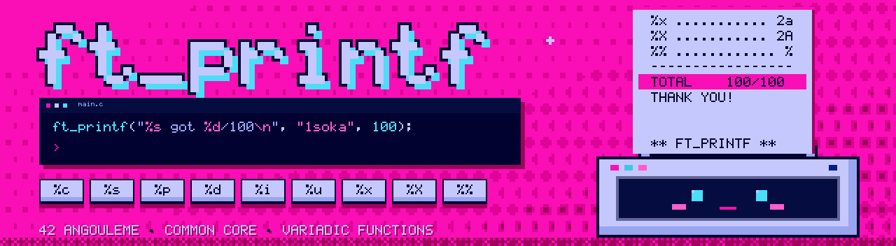

<p align="center"></p>

<div align="center">

# 🖨️ ft_printf — 42 Angoulême


<br>


</div>

## 📖 About

**ft_printf** is a project of the 42 common core. The goal is to recode the famous `printf` function from the C standard library: read a format string, replace each conversion with the right argument, and return the number of characters printed.

It is the first project where I had to work with **variadic functions** (`va_start`, `va_arg`, `va_end`), since `printf` can receive any number of arguments. The result is a static library, `libftprintf.a`. Every function follows the **Norminette**, and the whole project was checked by **Moulinette** and by peer evaluations.

---

## 📝 Result

<div align="center">
<table>
  <tr>
    <th>ft_printf</th>
  </tr>
  <tr>
    <td align="center"></td>
  </tr>
</table>
</div>

---

## 🔧 Prototype

```c
int	ft_printf(const char *format, ...);
```

It returns the **number of characters printed**, exactly like the real `printf`.

## 🔣 Conversions

| Conversion | Prints | Example |
|:---:|---|---|
| `%c` | A single character. | `ft_printf("%c", 'A')` → `A` |
| `%s` | A string. | `ft_printf("%s", "1soka")` → `1soka` |
| `%p` | A pointer address in hexadecimal, with the `0x` prefix. | `ft_printf("%p", ptr)` → `0x7ffe4a…` |
| `%d` | A signed decimal integer. | `ft_printf("%d", -42)` → `-42` |
| `%i` | A signed integer in base 10. | `ft_printf("%i", 42)` → `42` |
| `%u` | An unsigned decimal integer. | `ft_printf("%u", 3000000000u)` → `3000000000` |
| `%x` | A number in lowercase hexadecimal. | `ft_printf("%x", 42)` → `2a` |
| `%X` | A number in uppercase hexadecimal. | `ft_printf("%X", 42)` → `2A` |
| `%%` | A percent sign. | `ft_printf("%%")` → `%` |

## 🧠 How it works

| Step | What happens |
|:---:|---|
| 1 | `va_start` opens the list of extra arguments. |
| 2 | The format string is read character by character. |
| 3 | Normal characters are written as they are. |
| 4 | When a `%` is found, the next character tells which conversion to apply. |
| 5 | The matching helper takes the next argument with `va_arg` and prints it. |
| 6 | Every printed character is counted along the way. |
| 7 | `va_end` closes the list, and the total count is returned. |

---

## ⚙️ Usage

```bash
make        # build libftprintf.a
make clean  # remove object files
make fclean # remove object files and libftprintf.a
make re     # rebuild everything
```

Then include the header and link the library in your project:

```c
#include "ft_printf.h"

int	main(void)
{
	int	len;

	len = ft_printf("%s got %d/100\n", "1soka", 100);
	ft_printf("returned %d\n", len);
	return (0);
}
```

```bash
cc -Wall -Wextra -Werror main.c -L. -lftprintf
```

---

## 🗂️ Repository structure

```
Printf/
├── ft_printf.h     # Prototype and includes
├── ft_printf.c     # Format parsing and dispatch
├── ft_*.c          # Helpers for each conversion
├── Makefile        # Builds libftprintf.a
└── assets/         # Banner + grade badge used in this README
```

---

## 🏆 Final words

A big thank you to everyone at 42 Angoulême who reviewed my code and threw every tricky case at it, from `NULL` strings to `INT_MIN` and huge unsigned numbers. Recoding a function I had been using since my very first `Hello world` showed me everything that happens behind a single line of output. I came out of it **boosted**, and I really enjoyed it. 💗

After the **Hunter Exam** (Piscine), learning **Nen** (Libft) and **Greed Island** (get_next_line), ft_printf feels like the **Water Divination** test 💧: the same glass of water reacts differently depending on your Nen type, just like the same argument prints differently depending on `%d`, `%x` or `%c`. Next project, here I come! 🚀

<div align="center">

**Made with ☕, 💗 and a lot of segfaults by [1soka](https://github.com/1soka)**

</div>
